# Public Infrastructure Damage Reporting System
### Detailed Project Report

| | |
|---|---|
| **Author** | Shreyas Reddy |
| **Programme** | Internship project (Unified Mentor) |
| **Date** | 17 October 2026 |
| **Live application** | https://internship-infra-damage-reporting-system.onrender.com/ |
| **Source code** | https://github.com/shreyasreddycs6607-wq/internship-infra-damage-reporting-system |
| **Status document** | [PROGRESS.md](PROGRESS.md) · **Deployment guide** [DEPLOY.md](DEPLOY.md) · **Setup** [README.md](README.md) |

---

## Contents
1. [Abstract](#1-abstract)
2. [Problem statement and objectives](#2-problem-statement-and-objectives)
3. [Scope](#3-scope)
4. [Users and roles](#4-users-and-roles)
5. [Requirements and how each is met](#5-requirements-and-how-each-is-met)
6. [System design](#6-system-design)
7. [Database design](#7-database-design)
8. [Key workflows](#8-key-workflows)
9. [API overview](#9-api-overview)
10. [Security and privacy](#10-security-and-privacy)
11. [User interface walkthrough](#11-user-interface-walkthrough)
12. [Analytics and KPIs](#12-analytics-and-kpis)
13. [Testing and verification](#13-testing-and-verification)
14. [Deployment](#14-deployment)
15. [Challenges and how they were solved](#15-challenges-and-how-they-were-solved)
16. [Limitations](#16-limitations)
17. [Future work](#17-future-work)
18. [Conclusion](#18-conclusion)

---

## 1. Abstract
The project is a citizen-centred web platform with two connected parts.

* **Infrastructure damage reporting.** Residents report potholes, broken streetlights, water leaks, damaged footpaths and open drains with a photograph and a location. Municipal officers review, assign and resolve the reports through a controlled workflow, and every step is recorded and visible to the citizen. Administrators manage departments, categories, people and analytics.
* **Women-led home-business platform.** Women entrepreneurs publish a home-business profile (food, tailoring, beauty, handicrafts) with services, prices and photos, and receive step-by-step guidance. Customers browse **verified** businesses, search and filter them, contact owners through the platform, and rate them. Administrators approve profiles, handle complaints and manage the guidance content.

It is a complete working system: a server (backend) with a database, a browser application (frontend), automated tests, and a public deployment. Everything described in this report was run and tested; things that were not tested or are not built are listed in [Limitations](#16-limitations).

| Measure | Value |
|---|---|
| Backend code | about 1,930 lines in 17 files |
| Frontend code | about 1,150 lines |
| API endpoints | 74 |
| Database | 20 tables, 23 indexes, 5 versioned migrations |
| Automated tests | 68 tests in 7 files, all passing |
| Roles | 4 (citizen/customer, entrepreneur, officer, administrator) |

## 2. Problem statement and objectives
Public infrastructure problems are usually reported by phone or in person, are poorly documented, have no accountability, and cannot be tracked by the citizen. The result is slow repairs, safety hazards and public dissatisfaction. Separately, many women who run small home businesses lack visibility, pricing and compliance guidance, and a trusted way to be found by local customers.

**Primary objectives**
* Make it easy to report infrastructure damage.
* Provide located, photographic proof so reports are accurate.
* Improve transparency of resolution.
* Reduce response and repair time.

**Secondary objectives**
* Encourage citizen participation.
* Give authorities data for decisions (KPIs).
* Give women entrepreneurs guidance, visibility and a way to receive customer inquiries.

## 3. Scope
**In scope (delivered):** web-based reporting, image upload with location, status tracking, authority dashboard, administrator dashboard, business profiles, customer browsing and inquiries, complaints, guidance content, notifications.

**Out of scope for this phase (as specified):** native mobile application, AI-based damage detection. Online payment is also not included: the requirements describe the platform as being for discovery and inquiry, not instant payment.

## 4. Users and roles
| Role | What they do |
|---|---|
| **Citizen / customer** | Reports problems, tracks them, gives feedback, reopens a fix that failed. Also browses businesses, sends inquiries and service requests, rates businesses and files complaints. |
| **Women entrepreneur** | Owns one business profile, manages services, prices, availability and photos, answers inquiries, reads guidance, uses the cost and profit calculator. |
| **Officer** | Works reports of their department: reviews, accepts or rejects, is assigned work, updates progress, adds internal remarks and public updates, uploads resolution photos. A *team lead* officer can assign and reassign. |
| **Administrator** | Manages users and roles, departments, categories, business approvals, complaints and content; sees analytics, audit log and email/SMS delivery log; exports data. |

All permissions are enforced **on the server**. Hiding a button in the interface is never the only protection.

## 5. Requirements and how each is met

### 5.1 Infrastructure reporting
| Requirement | How it is met |
|---|---|
| Web-based damage reporting | Report form with category, title, description, 1–3 photos and location |
| Image upload with geo-location | Location can be taken from the device, chosen on a map, or typed. Each report states which method was used. The system does not claim device coordinates are verified. |
| Issue status tracking | Unique tracking number, nine-step status workflow, full history, public progress updates and resolution photos |
| Authority dashboard | Officer dashboard (assigned, awaiting review, in progress, overdue, workload), filterable and sortable report table, assignment history |
| Authority receives and assigns tasks | Assign and reassign with a recorded history; permission rules by department and team-lead role |
| KPIs | Average resolution time, resolved count, citizen satisfaction, repeated-issue rate (see [section 12](#12-analytics-and-kpis)) |

### 5.2 Women entrepreneurs, customers and administrators
| Requirement | How it is met |
|---|---|
| Registration and secure login | Self-registration as citizen/customer or entrepreneur; hashed passwords; revocable sessions |
| Home-business profile and the four categories | Tiffin / Home Food Service, Tailoring & Stitching, Beauty & Personal Care Services, Handicrafts & Handmade Products (administrators can add more) |
| Step-by-step business guidance: pricing, licensing and compliance, cost estimation, profit planning | Administrator-editable articles plus an interactive cost and profit calculator (break-even and suggested price) |
| Upload service details, images, pricing, availability | Services with price, unit and availability switch; up to 6 photos; "accepting requests" switch |
| Receive and respond to inquiries; track service requests | Message thread per inquiry and a request status workflow (new, replied, accepted, declined, completed, cancelled) |
| Marketing tips, learning and growth content | Administrator-managed articles in three groups: setup guidance, marketing tips, learning |
| Customers browse verified businesses | Only administrator-approved profiles are public, marked **Verified** |
| Search and filter by location, category, availability | Text search, category, city, "accepting requests now", sort by rating, and "near me" distance search |
| View detailed profiles; send inquiries; contact through the platform | Profile page with services, photos, approximate map area and reviews; in-platform messaging |
| Admin: approve profiles | Approve, reject or suspend with a reason that the owner sees |
| Admin: manage categories and listings | Business categories and infrastructure categories; suspend a listing |
| Admin: monitor activity | Platform activity counts and delivery log |
| Admin: handle complaints | Complaint queue with status and a response to the complainant |
| Admin: manage learning content | Create, edit, publish and delete articles |

### 5.3 Non-functional requirements
| Requirement | Status |
|---|---|
| Usability | Plain, labelled forms, clear status badges, empty/loading/error states, a "what happens next" note for citizens. **Not** tested with real users. |
| Performance (actions within 2 seconds) | Paginated lists, database indexes, capped payloads. **Not measured**: no load test was run. |
| Scalability | Limited by design: SQLite and one server instance. The next step would be PostgreSQL. |
| Security | See [section 10](#10-security-and-privacy) |
| Availability | Hosted on Render with a health check, persistent disk and daily database snapshot. Single instance, so a deploy briefly interrupts service. |
| Responsiveness | Works from phone width upward (checked at 375 px). |
| Reliability | Validated input, transactions on multi-step changes, clear errors, automated tests, backups. |
| Maintainability | Modular code (routes, workflow rules, analytics, notifications kept separate), versioned database migrations, tests, documentation. |
| Data privacy | Privacy notice, minimal data, no tracking cookies, opt-in email and SMS. Gaps: no self-service account deletion; photos keep their embedded metadata. |

### 5.4 Differences from the suggested technology
| Suggested | Used | Reason |
|---|---|---|
| React / Next.js; Tailwind or Bootstrap | Plain HTML, CSS and JavaScript single-page app | No build step, small and sufficient for this scope |
| Node.js and Express with REST | Same | |
| MongoDB or PostgreSQL | SQLite (Node's built-in `node:sqlite`) | Simplest reliable choice for one server; limits scale |
| AWS, Vercel or Netlify | Render | The app stores its database and photos on disk, which needs a persistent disk; Vercel and Netlify do not provide one |

## 6. System design

### 6.1 Architecture
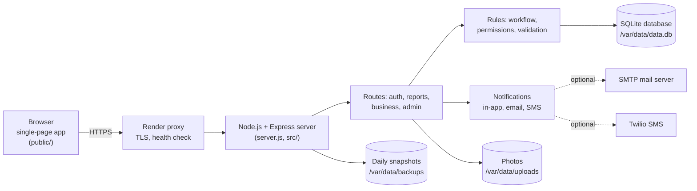
The browser never touches the database. It calls the server's API; the server checks who the caller is and what they may do, applies the business rules, and reads or writes the database.

### 6.2 Technology
| Layer | Technology |
|---|---|
| Server | Node.js 24, Express 4 |
| Database | SQLite via Node's built-in `node:sqlite` |
| File upload | Multer (in memory), validated by file content, stored on disk with random names |
| Email | Nodemailer over SMTP (optional) |
| SMS | Twilio REST API (optional) |
| Maps | Leaflet 1.9.4 with OpenStreetMap tiles |
| Frontend | Plain JavaScript, HTML, CSS |
| Tests | Node's built-in test runner |
| Hosting | Render (web service with a 1 GB persistent disk) |

### 6.3 Code organisation
```
server.js                 start-up, daily backup, graceful shutdown
src/app.js                middleware, sessions, rate limits, security headers, wiring
src/db.js                 database connection and the 5 versioned migrations
src/workflow.js           statuses, allowed transitions, who may do what to a report
src/analytics.js          KPI and platform statistics queries
src/notify.js, channels.js  in-app, email and SMS delivery with outcome tracking
src/images.js, util.js, users.js, backup.js
src/routes/auth.js        register, login, profile, verification, password reset, notifications
src/routes/reports.js     report lifecycle, dashboard, images, feedback
src/routes/business.js    business profiles, search, inquiries, reviews, complaints, content
src/routes/admin.js, admin-business.js   administration
scripts/create-admin.js   creates the first administrator
public/                   the browser application
tests/                    68 automated tests
render.yaml, DEPLOY.md    deployment
```

## 7. Database design
SQLite with foreign keys enforced, 20 tables and 23 indexes. Changes are made only through versioned migrations that run automatically at start-up; an existing database is upgraded without losing data (this was tested with a database in the original format).

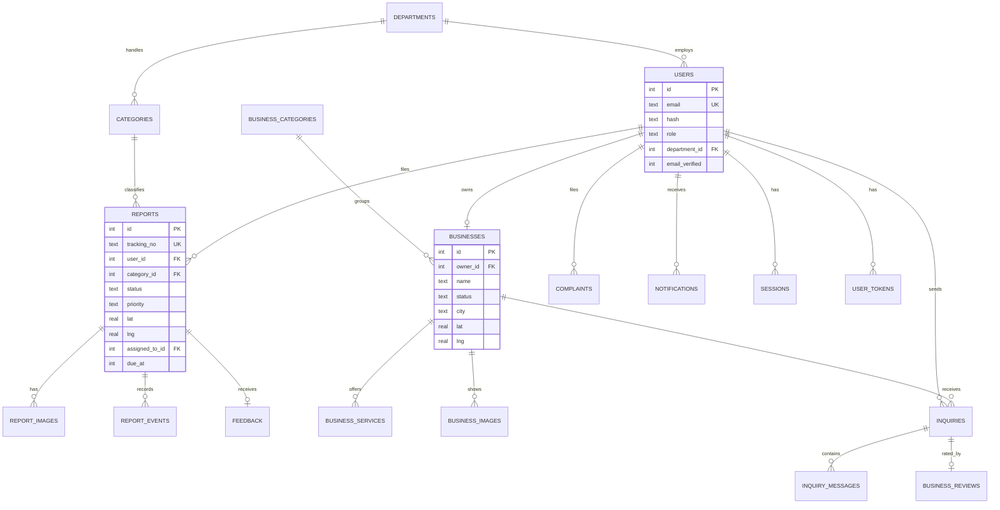

| Table | Purpose |
|---|---|
| `users`, `sessions`, `user_tokens` | Accounts, sign-in sessions (stored hashed), one-time verification and reset tokens (stored hashed) |
| `departments`, `categories` | Departments and infrastructure categories, with a target resolution time per category |
| `reports`, `report_images`, `report_events`, `feedback` | A report, its photos, the full timeline (status changes, assignments, remarks, priority changes) and citizen feedback |
| `business_categories`, `businesses`, `business_services`, `business_images` | Business profiles and what they offer |
| `inquiries`, `inquiry_messages`, `business_reviews` | Customer requests, their message threads, and ratings |
| `complaints`, `content` | Complaints and administrator-managed guidance articles |
| `notifications`, `audit_log` | In-app, email and SMS notifications with delivery outcome; record of privileged actions |

Design decisions: the report timeline is one table (`report_events`) so status history, assignment history and remarks are a single ordered record with an actor, a time and a visibility flag (internal or public). Database constraints (`CHECK`, `UNIQUE`, foreign keys) back up the application checks. Business locations are stored rounded to about 110 m.

## 8. Key workflows

### 8.1 Report lifecycle
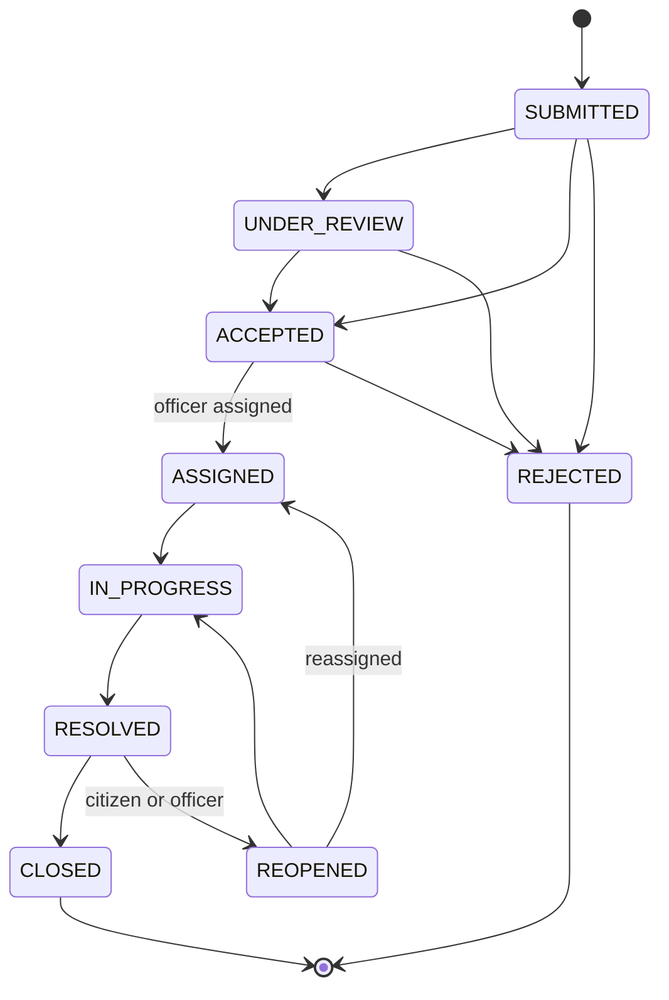
Only the transitions drawn are allowed; anything else is refused by the server. A rejection needs a reason, a resolution needs a resolution note, and a reopening needs the citizen's explanation. A status change is applied only if the report is still in the status the user saw, so two officers cannot silently overwrite each other. Citizens see public updates only; internal remarks and staff names are never sent to them.

### 8.2 Business profile review
A new profile starts as **Pending**. An administrator approves it (it becomes public with a Verified badge), rejects it with a reason, or later suspends it. A rejected owner edits the profile and resubmits.

### 8.3 Inquiry and service request
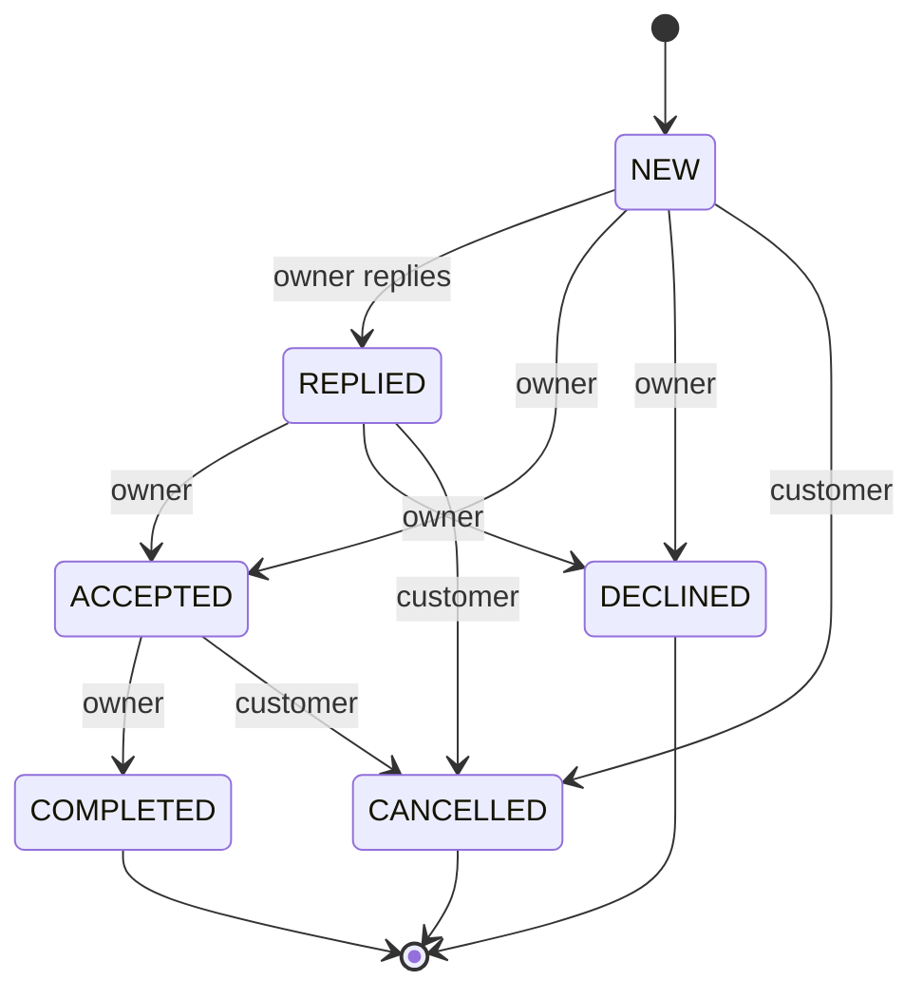
Only the customer and the business owner can read an inquiry. After a request is completed, the customer can rate the business once.

### 8.4 Account flows
Registration, optional email verification, sign-in, password change (signs out other devices), and password reset by email (single-use, valid for one hour, signs the user out everywhere). When no email provider is configured, nothing is blocked and an administrator can set a temporary password.

## 9. API overview
74 endpoints, all returning JSON (errors are `{ "error": "message" }`), grouped as follows.

| Group | Examples |
|---|---|
| Authentication | register, login, logout, current user, profile, verify email, forgot and reset password |
| Reports | create (with photos), list with filters, markers for the map, details, edit while unreviewed, status, assign, remarks, priority, resolution photos, feedback |
| Dashboards | officer and administrator dashboard figures, officer list |
| Businesses (public) | list with search, filters and distance, cities, details, photos |
| Businesses (owner) | own profile, services, photos |
| Inquiries | create, list, read, message, change status, rate |
| Complaints and content | file and list complaints, read guidance |
| Administration | users, departments, categories, business review, business categories, complaints, content, analytics, audit log, delivery log, CSV export |
| Operations | health check |

Lists are paginated, sort columns are whitelisted, and every identifier and body field is validated.

## 10. Security and privacy
| Area | Measure |
|---|---|
| Passwords | Salted scrypt hashes; never stored or logged in plain text |
| Sessions | Random tokens, only a hash stored; HttpOnly, SameSite=Strict, Secure in production; 7-day expiry; ended on logout, password change, role change and deactivation |
| Brute force | Rate limits on sign-in, registration, password reset, verification and creation endpoints; generic "invalid email or password" message with equalised timing |
| Cross-site requests | SameSite cookies plus rejection of cross-origin state-changing requests; no CORS |
| Authorisation | Role and ownership checks on the server for every endpoint. Someone else's report returns *not found*, so identifiers cannot be probed. |
| Workflow integrity | Allowed transitions only, required notes, conditional updates against stale data |
| Uploads | Only JPEG, PNG and WebP, identified by file content (not the name or the declared type); size and count limits; random file names; stored outside the web root and served only to authorised users |
| Injection | All database queries are parameterised; sort fields whitelisted; search wildcards escaped |
| Cross-site scripting | The browser application writes user text as plain text only; Content-Security-Policy `default-src 'self'` |
| Output safety | CSV export neutralises spreadsheet-formula injection |
| Email | Verification links and reset links are random, single-use and stored hashed; the "forgot password" answer is identical whether or not the address exists |
| Accountability | Audit log of privileged actions; delivery log of email and SMS |
| Privacy | A privacy notice page; email and SMS are opt-in; approximate business location only |
| Dependencies | `npm audit` reports 0 vulnerabilities |

## 11. User interface walkthrough
The interface is a single-page application with different navigation for each role. Screens below were captured from the running application using demonstration data.

**Sign in** — plain form with links to register, reset password and browse businesses.

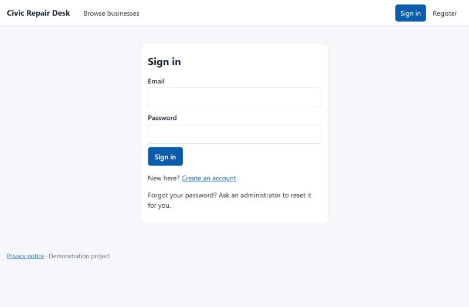

**Citizen: report a problem** — category, title, description and photos, then the location.

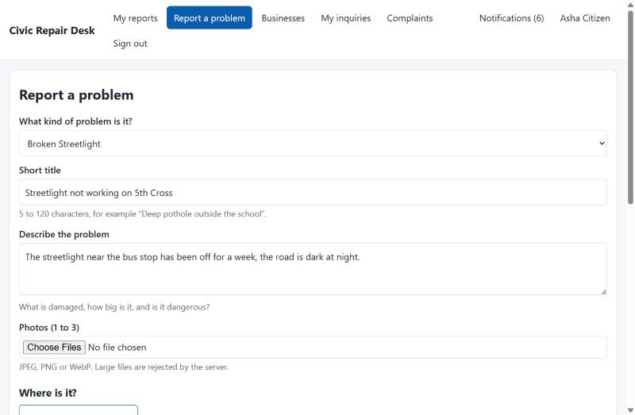

Location can be a map point, the device's position (if permitted), or a typed address. If location permission is denied, a message explains the alternatives.

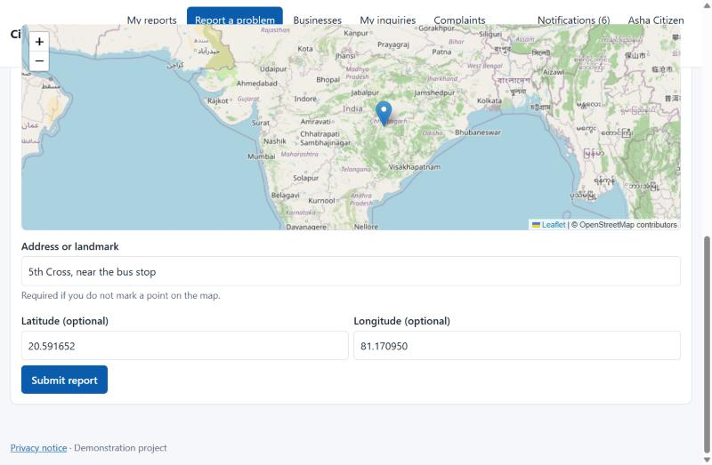

**Citizen: tracking a report** — status, priority, target date, location and photos, with a note saying what happens next.

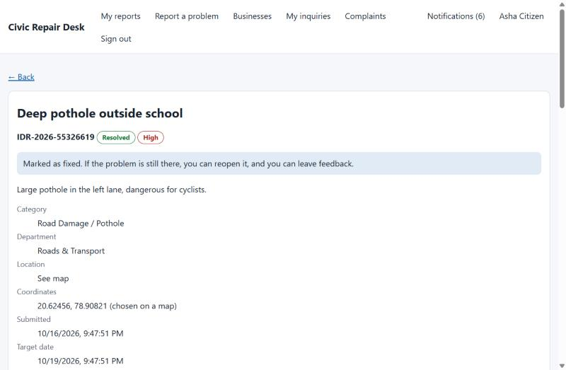

The history shows each step. Staff names appear only as "Municipal staff", and internal notes are hidden.

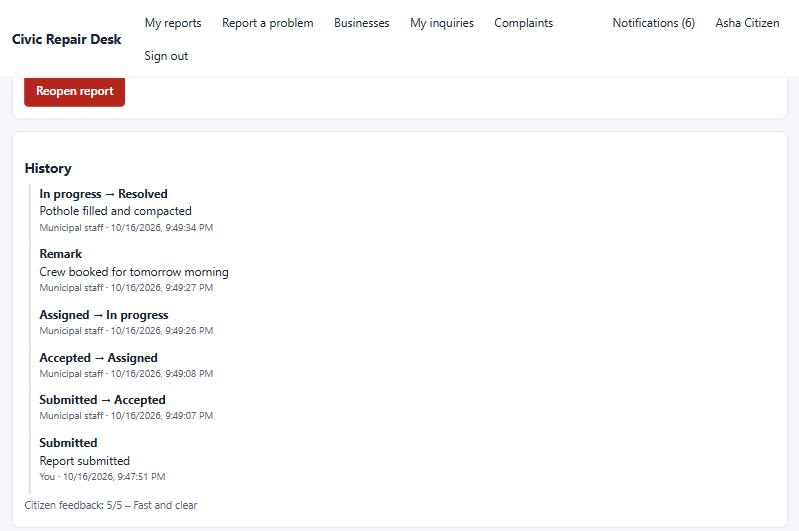

**Staff view of the same report** — includes the internal notes, priority change and assignment note, marked *Internal*.

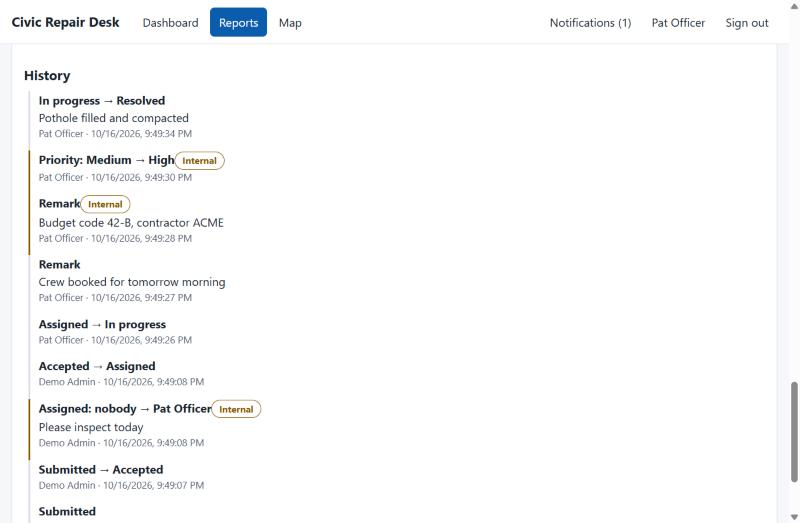

**Officer dashboard** — assigned work, awaiting review, in progress, overdue, workload and category breakdown.

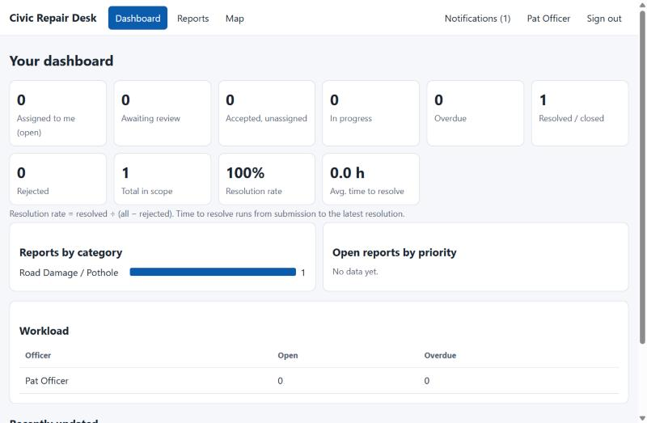

**Administrator dashboard** — the same figures system-wide, plus platform activity, export and navigation to all administration pages.

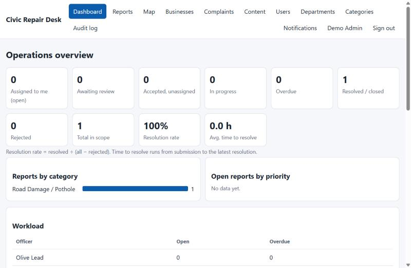

**Report map** — markers for reports the user is allowed to see, filterable by status and category.

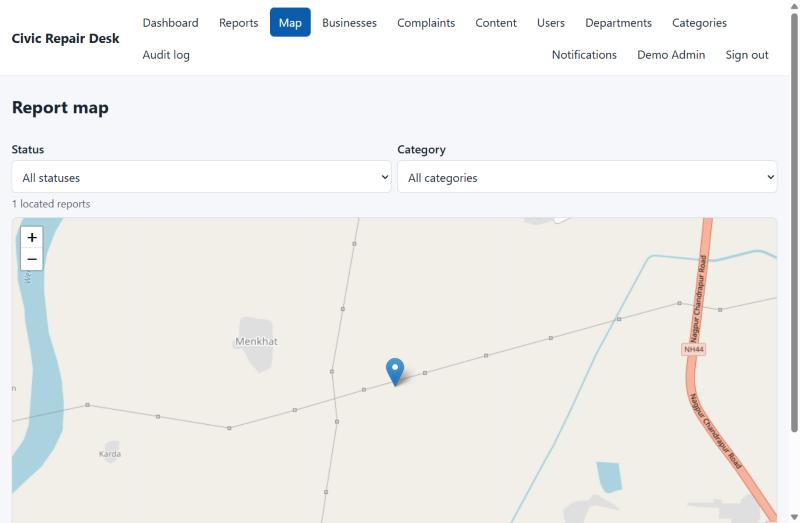

**Customers: browse verified businesses** — search, category, location, availability, sort, and "near me" with a distance.

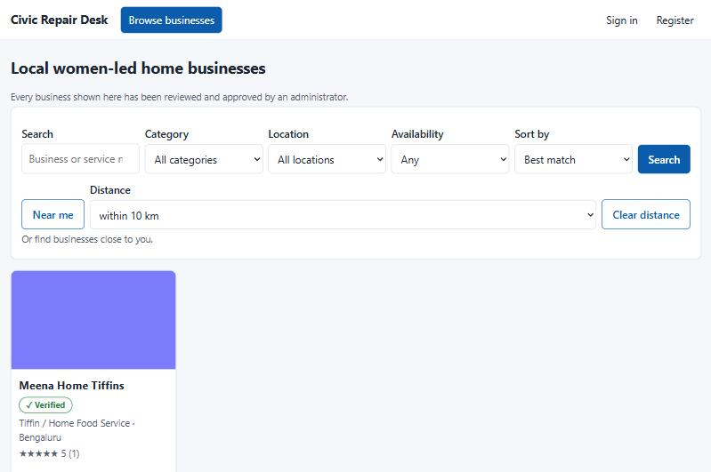

**Business profile** — verified badge, rating, availability, pricing and services.

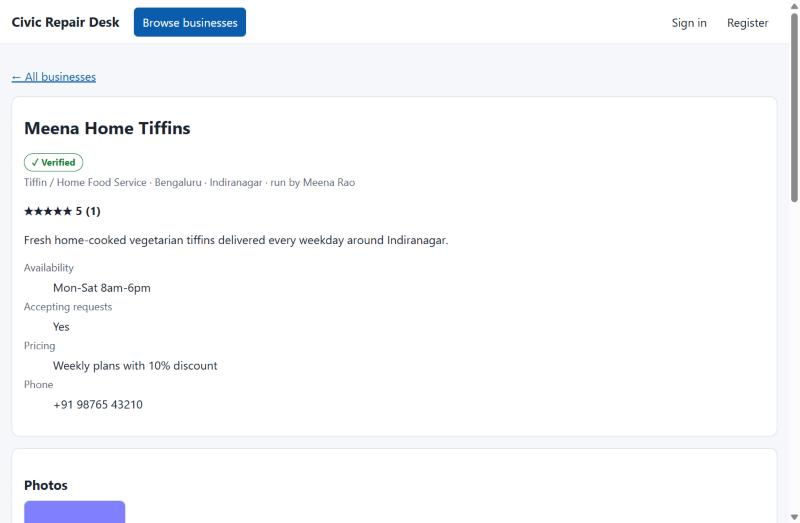

**Entrepreneur: manage the business** — profile, location, services and photos, with the approval status shown at the top.

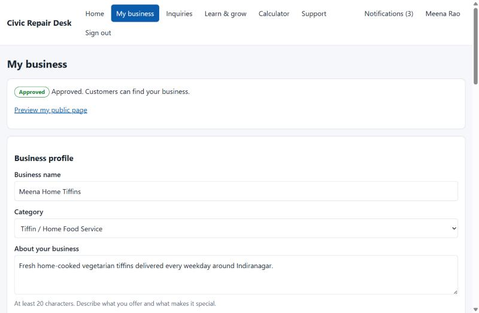

**Inquiry conversation** — messages, status, and the customer's rating once completed.

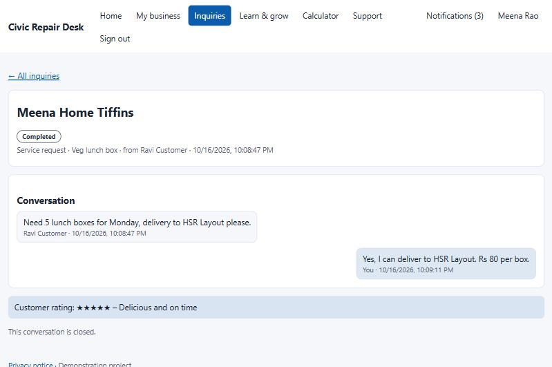

**Cost and profit calculator** — break-even units, monthly profit, the value of the owner's own time and a suggested price.

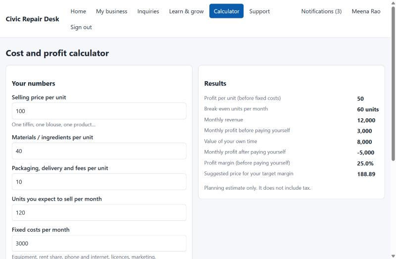

**Learning and guidance** — step-by-step setup, pricing strategies, compliance information, marketing tips.

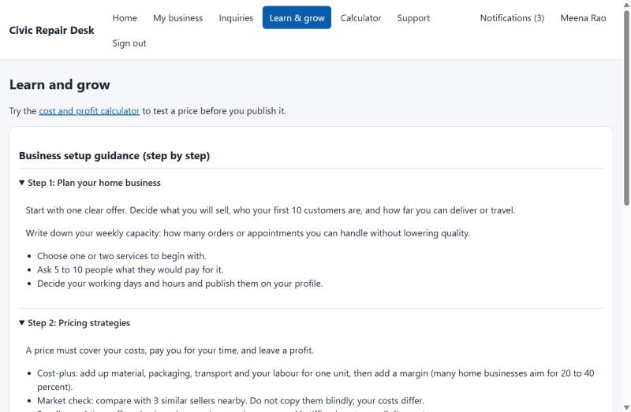

**Administrator: business review** — approve, reject or suspend profiles.

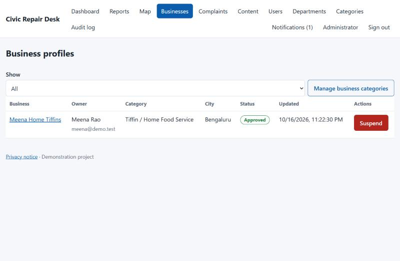

(The placeholder business image is a one-pixel test file, which is why the card image is a plain colour block.)

## 12. Analytics and KPIs
All figures are calculated from stored records, never from fixed numbers, and an empty database shows zero or "no data" rather than a misleading value.

| Measure | Definition |
|---|---|
| Open | status is not Resolved, Closed or Rejected |
| Awaiting review | Submitted or Under review |
| Overdue | open, and the target date (created time plus the category's target hours) has passed |
| Resolved | Resolved or Closed |
| **Average resolution time** | mean of (resolved time − submitted time) over resolved reports; none → "no resolved reports yet" |
| **Resolution rate** | resolved ÷ (all − rejected); not shown if the denominator is zero |
| **Citizen satisfaction** | average of the 1–5 feedback ratings |
| **Repeated-issue rate** | clusters of two or more reports of the same category within the same grid cell of about 110 m (approximate: neighbours across a cell edge are missed) |
| Busiest areas | report counts per grid cell of about 1 km |
| Workload | open and overdue reports per officer |
| Platform activity | users by role, business profiles by status, inquiries by status, complaints by status, approved businesses per category |

## 13. Testing and verification

### 13.1 Automated tests: 68, all passing
| File | Tests | Covers |
|---|---|---|
| `auth.test.js` | 11 | Registration, hashing, generic login errors, logout, protected endpoints, cross-origin blocking, password change, rate limit, error handling |
| `reports.test.js` | 12 | Report creation and validation, uploads, access control and ownership, officer workflow, invalid transitions, priority, search and filters, overdue, notification failure isolation |
| `admin.test.js` | 6 | Administration journey, analytics (including empty), user management, routing, deletion rules, migration of an old-format database |
| `business.test.js` | 13 | Roles, profile validation and approval, services, photos, search, inquiries, complaints, content, categories, platform statistics |
| `extras.test.js` | 11 | Email and SMS channels (including a real SMTP exchange with a local server), failure recording, ratings, near-me search, location privacy |
| `account.test.js` | 12 | Email verification, gating, password reset, token rules, expiry, rate limits |
| `backup.test.js` | 3 | Database backup and pruning, health check, rate limiting behind a proxy |

The tests start the real server in memory and call it over HTTP, so they exercise routes, rules and database together. The four required journeys are covered: **A** citizen reporting, **B** authority resolution, **C** administrative oversight, **D** security (unauthorised access).

### 13.2 Manual verification in a browser
Citizen report with a map point and photo, assignment and resolution with evidence, the citizen seeing only public updates; entrepreneur profile, administrator approval, visitor search, customer request, owner reply, rating, complaint and its resolution; email verification and password reset using real messages caught by a local mail server; the privacy page; phone-width layout.

### 13.3 Deployment check
The exact install and start steps were run from a fresh copy of the repository with production settings: health check passes, secure cookie and security headers present, the database and source files are not reachable from the web, the daily backup is written, data survives a restart. The live site answers its health check and refuses unauthenticated API calls.

### 13.4 Not tested
Real mail or SMS providers, load and speed targets, automated browser end-to-end tests, screen-reader accessibility, and whether the hosting disk keeps data across a redeploy (steps are in `DEPLOY.md`).

## 14. Deployment
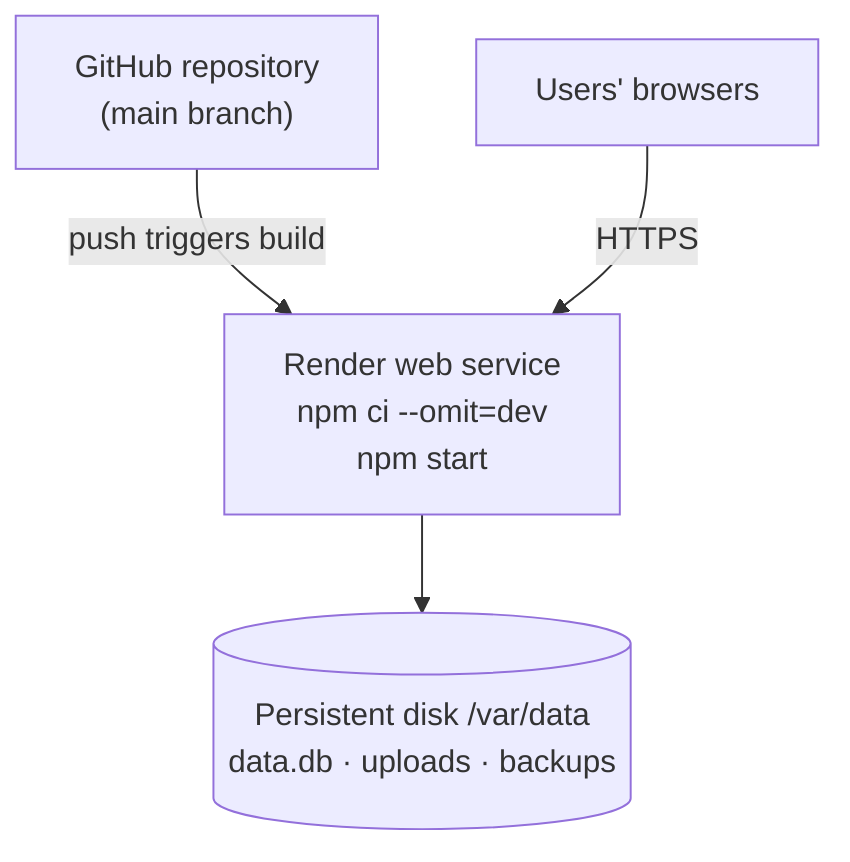
* Hosted on Render as one web service with a 1 GB persistent disk. A free instance cannot be used because it has no persistent disk, so the database and photos would be erased on restart.
* `render.yaml` describes the service; `DEPLOY.md` is the step-by-step guide (service creation, first administrator, optional email, checks, backups, troubleshooting).
* Production settings: secure cookies, strict transport security, one trusted proxy, data directories on the disk.
* The first administrator is created from the server's shell with a password the owner chooses. There is no default or hard-coded administrator account.
* A health-check URL lets the host restart the service if it fails; shutdown is graceful so in-flight emails finish; the database is copied daily and the newest seven copies are kept.
* No secrets are stored in the repository.

## 15. Challenges and how they were solved
| Challenge | Solution |
|---|---|
| The starting code had a hard-coded fallback signing secret and a seeded `admin123` administrator | Replaced with random session tokens; the migration disables the old default account; the first administrator is created from the environment |
| Keeping existing data while changing the whole database layout | Versioned migrations that copy old reports, photos and ratings into the new tables; tested with an old-format database |
| Preventing one user from guessing another user's report numbers | Unauthorised access returns "not found", the same as a missing record |
| Two officers editing the same report | Status changes apply only if the report is still in the status the user saw |
| Map tiles showed "Access blocked" | The browser had been told not to send a referrer to the tile server; the referrer policy was corrected |
| The page's security policy blocked inline styles used by the bar charts | Styles are set from code instead |
| Some screens printed `[object HTMLDivElement]` or "null" | The browser's child-replacement function converts arrays and null to text; a small wrapper flattens and skips them |
| Photo uploads can hide scripts behind a picture extension | File type is decided from the file's first bytes, not its name or declared type; names are replaced by random ones |
| Business "near me" search could reveal a home address | Locations are stored rounded to about 110 m, so nothing finer can be recovered |
| Rate limits could be dodged by faking a forwarded address header behind a proxy | The server trusts only the configured number of proxies; tested with spoofed headers |
| A mail library version had known vulnerabilities | Upgraded to the current release; audit now clean |
| Vercel and Netlify cannot keep a database file | Chose Render with a persistent disk instead of rewriting the data layer |

## 16. Limitations
* **Scale:** SQLite and an in-memory rate limiter allow only one server instance.
* **Not measured:** response-time targets; no load test.
* **Email and SMS** work only when configured and were not tried with real providers.
* **Registration** reveals whether an email address is already used; the email address of an account cannot be changed.
* **Photos** are not resized, keep their embedded metadata, and are not virus-scanned.
* **Data protection:** accounts can be deactivated but not permanently deleted by the user.
* **Report routing:** a report is routed to a department when filed; changing a category's department later does not re-route existing reports (an administrator's assignment does).
* **Near-me search** ignores wrap-around at the 180° meridian and considers at most 2,000 businesses.
* **Reviews** can be removed only by an administrator.
* **Accessibility** basics are implemented (labels, focus, skip link) but no screen-reader audit was run.
* **No browser end-to-end test suite** and no continuous-integration pipeline.

## 17. Future work
1. Automated browser end-to-end tests and an accessibility audit.
2. PostgreSQL and a shared rate limiter to run several instances.
3. Image resizing and metadata removal; account deletion; changing the email address.
4. Off-site backups and a continuous-integration pipeline.
5. The enhancements named in the requirements: a public issue heat map, AI-assisted categorisation, and a mobile application.

## 18. Conclusion
The system delivers what the project description asks for in one working application: a transparent, trackable way for citizens to report and follow infrastructure repairs, a controlled workflow for officers and administrators with measurable KPIs, and a verified marketplace with guidance for women-led home businesses. It is secured, tested (68 automated tests plus browser verification), documented and publicly deployed. Its main limits are scale (a single server with SQLite) and the items that need real provider accounts or further testing, all of which are stated above.
